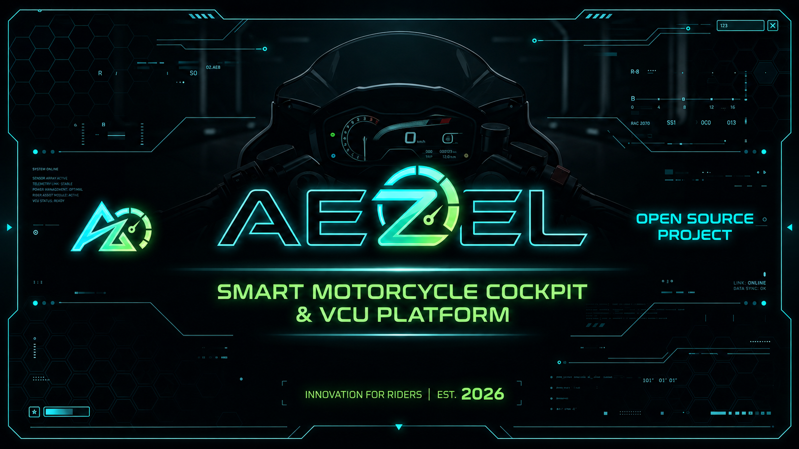
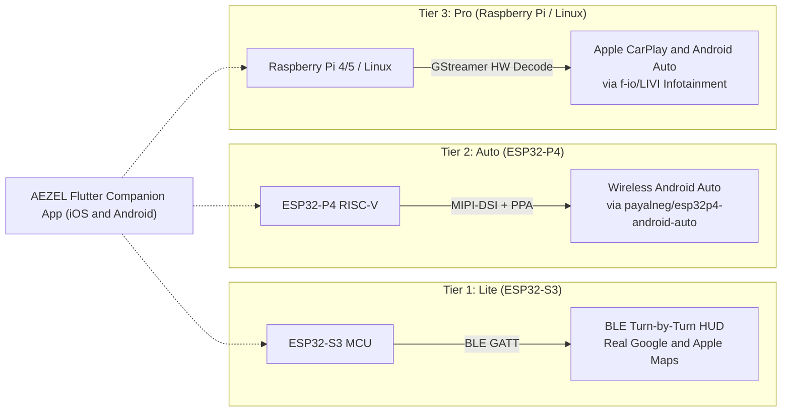
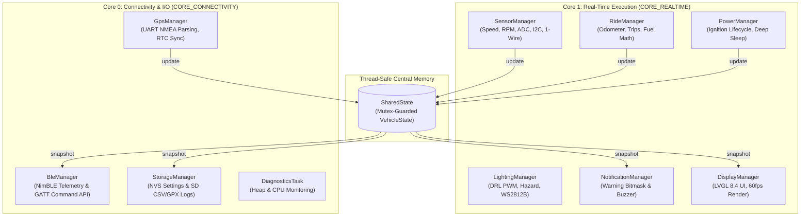

<div align="center">



# AEZEL — Universal Multi-Vehicle & Multi-Hardware Connected Cockpit Platform

**Modular Vehicle Control Unit (VCU) • Real-Time Digital Dashboard • Bikes, Scooters & Cars • Direct Sensors & OBD-II • ESP32-S3 & Raspberry Pi**

[](LICENSE)
[](platformio.ini)
[](CMakeLists.txt)
[](https://lvgl.io)
[](test/native/)
[](https://github.com/sponsors/ijlaal1610)
[](https://buymeacoffee.com/ijlaalakhtar)
[](https://ko-fi.com/ijlaalakhtar)
[](https://paypal.me/ijlaalakhtar)

---

### *Universal open-source connected cockpit platform supporting Motorcycles, Scooters, and Cars with direct sensor acquisition, CAN Bus / OBD-II, and multi-hardware HAL (ESP32-S3 & Raspberry Pi).*

</div>

---

> [!IMPORTANT]
> 🗺️ **Active Project Roadmaps & Technical Architecture Specifications**:
> - 📋 **[Master Firmware & Hardware Roadmap (Phases 0–6)](docs/roadmap.md)**: From bench MVP and FreeRTOS task graphs to Apple CarPlay & Android Auto across our 3 hardware tiers.
> - 🧭 **[Cross-Platform Companion & Navigation Roadmap](docs/navigation_and_telemetry_roadmap.md)**: Unified Flutter companion app (iOS & Android), zero-API Google & Apple Maps HUD mirroring, and deep technical specs for ESP32-P4 & LIVI.
> - 🌐 **[Live Interactive Roadmap on Project Website](https://ijlaal1610.github.io/AEZEL/#roadmap)**: Real-time dynamic sync from `docs/roadmap.md` with completion meters and interactive phase accordions.

---

## 📑 Table of Contents

- [Overview](#-overview)
- [Universal Vehicle Support](#-universal-vehicle-support)
- [Multi-Hardware HAL Architecture](#-multi-hardware-hal-architecture)
- [Key Features](#-key-features)
- [Cross-Platform Navigation & Telemetry](#-cross-platform-navigation--telemetry-android--ios)
- [System Architecture](#-system-architecture)
- [Quick Start & Builds](#-quick-start--builds)
- [Repository Layout](#-repository-layout)
- [Hardware Safety & Wiring](#-hardware-safety--wiring)
- [Documentation Index](#-documentation-index)
- [Safety Notice & Disclaimer](#-safety-notice--disclaimer)
- [💖 Support & Sponsorship](#-support--sponsorship)
- [Contributing & Governance](#-contributing--governance)
- [License](#-license)

---

## 🚀 Overview

**AEZEL** is an open-source universal connected cockpit and Vehicle Control Unit (VCU) platform. Originally developed for motorcycles, AEZEL now features a modular architecture that natively supports:
- **Motorcycles (Bikes)**: Manual 5/6-speed transmission, lean angle tracking, side-stand monitoring, chain maintenance intervals.
- **Scooters**: CVT automatic transmission, centrifugal clutch, belt drive wear inspection intervals.
- **Cars (Automobiles)**: Manual and Automatic (P-R-N-D), dual G-force crash detection, OBD-II powertrain diagnostics (RPM, Speed, Coolant Temp, Throttle Position, Engine Load).

Instead of being just a digital display, AEZEL acts as a complete **Vehicle Control Unit (VCU)**, operating across both **Direct Sensors (Non-OBD)** and **OBD-II CAN Bus / Hybrid** modes.

Through a clean **Hardware Abstraction Layer (HAL)** in a single unified codebase, AEZEL runs seamlessly on **ESP32-S3 microcontrollers** as well as **Raspberry Pi / Linux Single Board Computers (SBCs)** without maintaining separate divergent branches.

---

## 🏍️🚗 Universal Vehicle Support

AEZEL includes 6 pre-configured vehicle profiles persisted in non-volatile memory and switchable via touchscreen or BLE companion app:

| Preset Name | Vehicle Class | Telemetry Source | Transmission | Tacho Scale | Special Features |
| :--- | :---: | :---: | :---: | :---: | :--- |
| **Bike (Direct/Non-OBD)** | Motorcycle | Direct Sensors | 5-Speed Manual | 0–12,000 RPM | Lean angle, side-stand, chain lube reminder |
| **Bike (OBD Hybrid)** | Motorcycle | Hybrid (CAN + IMU) | 6-Speed Manual | 0–14,000 RPM | Throttle & engine load bars, lean angle |
| **Scooter (Direct/CVT)** | Scooter | Direct Sensors | CVT Automatic | 0–9,000 RPM | "CVT" display, drive belt wear alerts |
| **Scooter (OBD Hybrid)** | Scooter | Hybrid (CAN + IMU) | CVT Automatic | 0–10,000 RPM | OBD coolant, throttle %, drive belt alerts |
| **Car Manual (OBD-II)** | Automobile | OBD-II / CAN Bus | 5-Speed Manual | 0–7,000 RPM | G-force crash alarm, coolant, load |
| **Car Auto (OBD-II)** | Automobile | OBD-II / CAN Bus | Automatic (P-R-N-D) | 0–7,000 RPM | Automatic PRND indicator, coolant, load |

---

## 💻 Multi-Hardware HAL Architecture

AEZEL employs a Core + HAL decoupled architecture:
- **Portable Business Core**: Vehicle math, profile engine, state management, notification pipeline, and LVGL UI run 100% on standard C++17.
- **HAL Interfaces (`include/hal/`)**:
  - `IHalGpio`: Digital I/O, PWM dimming, edge interrupts.
  - `IHalCan`: TWAI (ESP32) and SocketCAN (Linux/Raspberry Pi `can0`).
  - `IHalBle`: NimBLE GATT (ESP32) and BlueZ / companion socket (Linux).
  - `IHalStorage`: Preferences / SD (ESP32) and JSON key-value file storage (Linux).

---

## ✨ Key Features

| Category | Feature | Description |
| :--- | :--- | :--- |
| **Instrumentation** | Speedometer | Pulse-interval Hall timing + Exponential Moving Average (EMA) smoothing |
| | Tachometer | Coil-negative pickup or OBD-II PID with 60 FPS LVGL arc gauge |
| | Gear Position | Calculated gear state (`N`, `1`–`6`), `"CVT"`, or `"P-R-N-D"` automatic |
| **Telemetry & Sensors** | Environmental | Dual DS18B20 1-Wire sensors (Engine & Ambient temp) + BMP280 Altitude/Baro |
| | Dynamics / IMU | MPU6050 Accelerometer/Gyro for real-time lean angle, pitch & crash detection |
| | Electrical | Dual ADC monitoring for Battery Voltage & Charging-line health |
| | Fuel Analytics | Analog float sender ADC with self-calibrated range & consumption estimation |
| **Vehicle Powertrain** | CAN Bus / OBD-II | 500 kbps TWAI / SocketCAN cyclic polling (RPM, Speed, Coolant, Throttle, Load) |
| **Motorcycle Signals** | Discrete Inputs | Debounced opto-isolated reads for Indicators, High Beam, Horn, Side Stand, Brakes, Clutch |
| **Navigation & Time** | GPS, Turn-by-Turn & RTC | NEO-6M/8M NMEA parsing, GPS speed cross-check, DS3231 RTC atomic sync, Cross-Platform (Android & iOS) BLE turn-by-turn navigation HUD & Phone-assisted GPS fallback |
| **UI & Experience** | LVGL 8.4 Dashboard | 60 FPS digital dashboard, customizable themes (`Modern`, `Sport`, `Neon`, `Retro`) |
| | Power Lifecycle | Ignition-triggered state machine (`Active` → `Linger` → `Safe Shutdown` → `Deep Sleep`) |
| **Connectivity & Security** | BLE Telemetry | 2 Hz JSON GATT telemetry service + Remote command API via NimBLE |
| | Warning Pipeline | 16-flag bitmask engine → prioritized alert banners & Piezo buzzer chimes |
| | Multi-Hardware | Runs on ESP32-S3 and Raspberry Pi / Linux SBCs via abstract HAL |
| | Unit Testing | Comprehensive hardware-independent test suite (83 passed tests) |

---

## 🧭 Cross-Platform Navigation, Apple CarPlay & Android Auto

AEZEL spans across **Three Hardware Tiers** to support everything from commuter motorcycles and scooters to high-performance electric vehicles and custom automobiles:



- **Tier 1 — AEZEL Lite (ESP32-S3 Microcontroller)**:
  - 60 FPS LVGL 8.4 digital instrument cluster.
  - Zero-cost BLE Turn-by-Turn HUD mirroring official Google Maps (Android `NotificationListenerService` via [`Shr-c0de/navHUD`](https://github.com/Shr-c0de/navHUD)) and Apple Maps (iOS CoreBluetooth & ANCS).
  - High-efficiency u-blox NEO-6M GNSS filtering & phone-assisted GPS fallback (via [`Circuit-Digest`](https://github.com/Circuit-Digest/Simple-GPS-Tracker-using-ESP32---Visualize-Data-on-Map) and [`and0789`](https://github.com/and0789/Android-GPS-Bluetooth-Communication-with-ESP32)).
- **Tier 2 — AEZEL Auto (ESP32-P4 RISC-V SoC)**:
  - Dual-core 400 MHz RISC-V with 800×480 MIPI-DSI and hardware PPA 2D acceleration.
  - Native Wireless Android Auto video projection over Wi-Fi 6 with VCU CAN telemetry overlay (inspired by [`payalneg/esp32p4-android-auto`](https://github.com/payalneg/esp32p4-android-auto)).
- **Tier 3 — AEZEL Pro (Raspberry Pi 4/5 / Linux SBC)**:
  - Full In-Vehicle Infotainment powered by [`f-io/LIVI`](https://github.com/f-io/LIVI) (Rust + Slint UI) on AEZEL's Linux HAL (`src/hal/linux_pi/`).
  - Native **Apple CarPlay** (wired & wireless) and **Android Auto** (wired & wireless) with zero-copy GStreamer hardware acceleration, Siri/Google Assistant, and split-screen telemetry.
- **AEZEL Flutter Companion App (`app/` for iOS & Android)**:
  - Live cockpit dashboard, vehicle preset switcher (6 profiles), remote vehicle controls, maintenance interval tracking, and one-tap Wi-Fi OTA firmware flashing.

---

## 🏗️ System Architecture

AEZEL splits execution across the ESP32-S3's two Xtensa cores to guarantee that background storage or wireless communications never steal render cycles from the 60 FPS instrumentation display:



---

## ⚡ Quick Start & One-Command Setup

AEZEL includes an automated setup script that installs all build tools, compiles the firmware, and validates Wokwi hardware simulation in one step.

### 1. Clone & Setup
```bash
git clone https://github.com/ijlaal1610/AEZEL.git
cd AEZEL
./setup.sh
```

### 2. Available Commands
* **Build Firmware Binary**:
  ```bash
  ./setup.sh
  ```
* **Flash Connected ESP32 Hardware**:
  ```bash
  ./setup.sh --upload
  ```
* **Run Wokwi Hardware Simulation**:
  ```bash
  ./setup.sh --sim
  ```

---

## 📁 Repository Layout

```
AEZEL/
├── include/
│   ├── Config.h             # Pin mapping & hardware constants (single source of truth)
│   ├── DataModel.h          # SharedState — mutex-guarded live vehicle state
│   ├── VehicleProfile.h     # Multi-vehicle data definitions (Bike, Scooter, Car)
│   ├── VehiclePresets.h     # 6 built-in presets (Direct, OBD-II, Hybrid)
│   ├── VehicleConfig.h      # Active profile manager & NVS persistence
│   ├── VehicleMath.h        # Portable vehicle math functions (pulses, EMA, fuel)
│   └── hal/                 # Hardware Abstraction Layer interfaces
│       ├── IHalGpio.h       # Abstract GPIO, PWM, and edge interrupts
│       ├── IHalCan.h        # Abstract CAN Bus / TWAI driver
│       ├── IHalBle.h        # Abstract Bluetooth Low Energy GATT
│       ├── IHalStorage.h    # Abstract Key-Value & SD Card storage
│       └── HalProvider.h    # Central registry for active HAL instance
├── src/
│   ├── main.cpp             # Boot sequence & FreeRTOS task graph initialization
│   ├── VehicleConfig.cpp    # Profile loading, switching & storage
│   ├── VehicleMath.cpp      # Pure C++17 math implementations
│   ├── hal/                 # Concrete platform implementations
│   │   ├── esp32/           # ESP32-S3 drivers (TWAI, NimBLE, Preferences, LEDC)
│   │   └── linux_pi/        # Linux & Raspberry Pi drivers (SocketCAN, JSON, POSIX)
│   └── managers/            # Modular subsystem managers
│       ├── BleManager.cpp   # Companion app GATT service & remote commands
│       ├── CanManager.cpp   # OBD-II PID cyclic query engine & CAN parser
│       ├── DisplayManager.cpp # LVGL 8.4 dashboard composition & 60fps render loop
│       ├── GpsManager.cpp   # NMEA GPS sentence parsing & RTC discipline
│       ├── LightingManager.cpp # Auto-DRL, hazard relay & WS2812B RGB accents
│       ├── NotificationManager.cpp # Warning pipeline & Piezo buzzer chimes
│       ├── OtaManager.cpp   # Web-based wireless firmware update AP
│       ├── PowerManager.cpp # Ignition lifecycle state machine & deep sleep
│       ├── RideManager.cpp  # Odometer, trip computer & consumption integration
│       ├── SensorManager.cpp # Speed, RPM, ADC, I2C IMU/Baro, 1-Wire acquisition
│       └── StorageManager.cpp # NVS flash settings & SD card GPX/CSV logging
├── test/
│   └── native/              # Hardware-free C++17 unit tests (83 passed)
│       ├── test_vehicle_math.cpp    # Pulses, EMA filters, fuel calibration
│       ├── test_vehicle_profile.cpp # 6 presets, scale limits, profile switches
│       └── test_hal_linux.cpp       # Linux GPIO, SocketCAN, JSON storage, BLE
├── docs/                    # Architectural specs, BOM, schematics, and guides
├── CMakeLists.txt           # Native Linux & Raspberry Pi build system
├── platformio.ini           # PlatformIO build environments (esp32-aezel & native)
└── setup.sh                 # One-command installer & build script
```

---

## 🔌 Hardware Safety & Wiring Notes

> [!CAUTION]
> **Read before wiring any motorcycle harness connections:**

- **Opto-Isolation**: Never connect 12V motorcycle harness lines directly to ESP32 GPIOs. Discrete inputs (indicators, brake switches, kill switch, ignition) must use opto-isolators or properly rated voltage dividers with Zener/TVS clamping.
- **Transients & Load-Dump**: Motorcycle electrical systems experience severe load-dump voltage spikes (>40V). Battery and charging sensing circuits must include TVS diodes across ADC inputs.
- **Power Supply**: The board must power off a dedicated automotive buck converter connected directly to battery-positive with reverse-polarity protection. Ignition is read as a logic signal only.
- **Coil Noise**: The RPM pickup line carries high-frequency ignition coil noise; a dedicated RC low-pass filter ahead of the opto-isolator is required to prevent erratic readings.

---

## 📚 Documentation Index

- 🛡️ [`docs/remote_control.md`](docs/remote_control.md) — Isolated RemoteControlManager safety interlocks & actuator safety rules
- 🏗️ [`docs/incremental_build.md`](docs/incremental_build.md) — Staged hardware build roadmap & peripheral probes
- 🛵 [`docs/vehicle_compatibility_avenger_jupiter.md`](docs/vehicle_compatibility_avenger_jupiter.md) — Vehicle compatibility matrix & harness wiring for Bajaj Avenger 150 (2015) & TVS Jupiter ZX (2017)
- 🌐 [`docs/ota_can_and_navigation.md`](docs/ota_can_and_navigation.md) — Over-The-Air Wi-Fi updates, Automotive CAN Bus (TWAI) & Turn-by-Turn Navigation
- 💰 [`docs/modular_budget_build.md`](docs/modular_budget_build.md) — Modular budget upgrade roadmap ($15–$55) & non-blocking peripheral probes
- 📱 [`docs/smartphone_remote_control.md`](docs/smartphone_remote_control.md) — BLE GATT remote control specification, JSON commands & app code
- 🔬 [`docs/features_deep_dive.md`](docs/features_deep_dive.md) — Low-level technical deep dive into every single feature & math formula
- ❓ [`docs/faq_and_qna.md`](docs/faq_and_qna.md) — Comprehensive technical Q&A reference & architectural decisions
- ⚡ [`docs/hardware_schematics_and_pinout.md`](docs/hardware_schematics_and_pinout.md) — Complete GPIO pinout table, voltage dividers & protection schematics
- 🧩 [`docs/subsystem_managers_guide.md`](docs/subsystem_managers_guide.md) — Architecture & execution breakdown for all 9 subsystem managers
- 📱 [`docs/ble_telemetry_protocol.md`](docs/ble_telemetry_protocol.md) — BLE GATT service UUIDs, 2 Hz JSON payload & Android/iOS code snippets
- 🔐 [`docs/data_model_and_thread_safety.md`](docs/data_model_and_thread_safety.md) — SharedState data model, FreeRTOS mutex rules & concurrency
- 🛠️ [`docs/developer_onboarding_and_toolchain.md`](docs/developer_onboarding_and_toolchain.md) — PlatformIO, Wokwi CLI, setup.sh & hardware flashing guide
- 🏍️ [`docs/motorcycle_harness_integration_guide.md`](docs/motorcycle_harness_integration_guide.md) — On-bike wiring, ignition coil tap & bench testing checklist
- ⭐ [`docs/features.md`](docs/features.md) — Comprehensive feature specification & boot animation details
- ⚡ [`docs/power_and_animations.md`](docs/power_and_animations.md) — Power architecture, ignition sensing & animation guide
- 📋 [`docs/bom.md`](docs/bom.md) — Complete Bill of Materials and recommended components
- ⚡ [`docs/power_distribution.md`](docs/power_distribution.md) — Power tree, buck regulation, and transient protection
- 🔌 [`docs/wiring.md`](docs/wiring.md) — Harness wiring diagrams, opto-coupler circuits, and routing
- 🎯 [`docs/calibration.md`](docs/calibration.md) — Wheel circumference, fuel sender curve, and IMU calibration
- 🧪 [`docs/testing_checklist.md`](docs/testing_checklist.md) — Bench testing and on-bike safety verification
- 🗺️ [`docs/roadmap.md`](docs/roadmap.md) — Subsystem expansion roadmap (CAN bus, navigation, companion app)
- 🧭 [`docs/navigation_and_telemetry_roadmap.md`](docs/navigation_and_telemetry_roadmap.md) — Cross-platform (Android & iOS) Turn-by-Turn Navigation, GNSS Telemetry & Phone Fallback Architecture
- 💾 [`docs/nvs_layout.md`](docs/nvs_layout.md) — NVS flash key-value schema

---

## ⚠️ Safety Notice & Disclaimer

> [!WARNING]
> **SAFETY NOTICE**: AEZEL is an experimental open-source platform. Any features that interact with a motorcycle's electrical or control systems must be thoroughly tested on a bench supply before on-road installation. The authors, maintainers, and contributors accept no responsibility or liability for property damage, personal injury, vehicle failure, or legal issues resulting from the use, modification, or deployment of this software or hardware.

---

## 💖 Support & Hardware Prototyping Fund

AEZEL is an independent, 100% open-source connected vehicle ecosystem built for the community. We don't sell proprietary hardware lock-ins or charge for software features.

If AEZEL has saved you time, inspired your custom EV build, or you'd like to accelerate the **ESP32-P4 RISC-V Android Auto** and **Raspberry Pi CarPlay** milestones, your sponsorship makes a massive direct impact!

### 🎯 What Your Sponsorship Funds:
- 🔬 **ESP32-P4 RISC-V Development Hardware**: Silicon evaluation boards and 800×480 MIPI-DSI ST7701 touch displays.
- 🏍️ **Automotive Bench Harnesses & Opto-Isolation Rigs**: Oscilloscope validation and 12V transient surge testing rigs.
- 📡 **Dual-Band GNSS Hardware**: High-precision u-blox NEO-M8N / M9N receiver modules and active patch antennas.
- 🔌 **CAN Bus Transceivers**: MCP2515 controllers and TJA1050 / SN65HVD230 transceivers for real ECU integration.

<div align="center">

[](https://github.com/sponsors/ijlaal1610)
[](https://buymeacoffee.com/ijlaalakhtar)
[](https://ko-fi.com/ijlaalakhtar)
[](https://paypal.me/ijlaalakhtar)

<br/>

**🇮🇳 Direct UPI (India)**: `ijlaal@slc`

</div>

---

## 👥 Contributing & Governance

Contributions to AEZEL are welcome! Whether you are implementing new subsystem managers, refining LVGL UI components, or improving sensor math:

- 📖 Read our [**Contributing Guide**](CONTRIBUTING.md) for pull request workflows.
- 📜 Adhere to the [**Code of Conduct**](CODE_OF_CONDUCT.md).
- 🛡️ Review our [**Security Policy**](SECURITY.md) to report vulnerabilities.
- 📝 Check the [**Changelog**](CHANGELOG.md) for version release details.

---

## 📜 License

AEZEL is licensed under the **[Apache License 2.0](LICENSE)**. 

```
Copyright 2026 AEZEL Contributors

Licensed under the Apache License, Version 2.0 (the "License");
you may not use this file except in compliance with the License.
You may obtain a copy of the License at

    http://www.apache.org/licenses/LICENSE-2.0

Unless required by applicable law or agreed to in writing, software
distributed under the License is distributed on an "AS IS" BASIS,
WITHOUT WARRANTIES OR CONDITIONS OF ANY KIND, either express or implied.
See the License for the specific language governing permissions and
limitations under the License.
```
